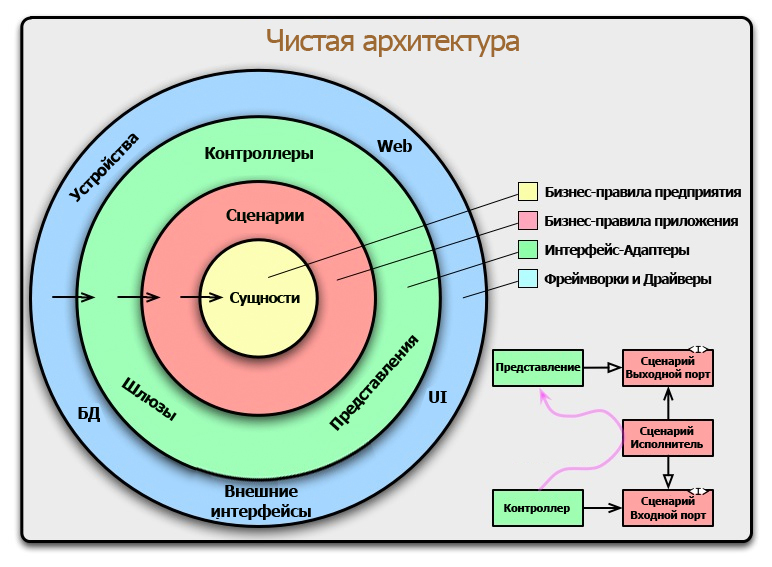
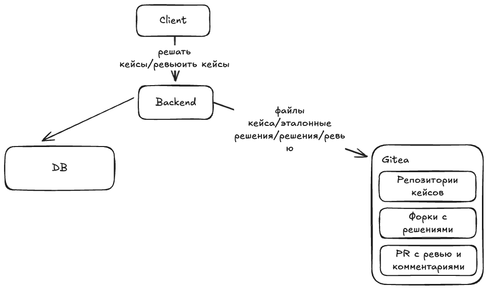
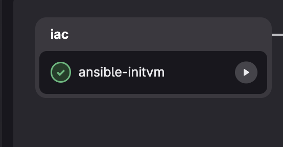
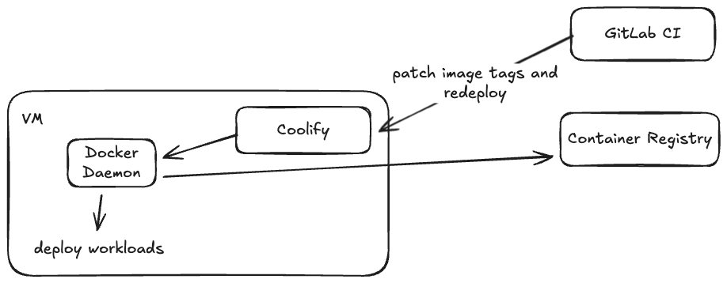
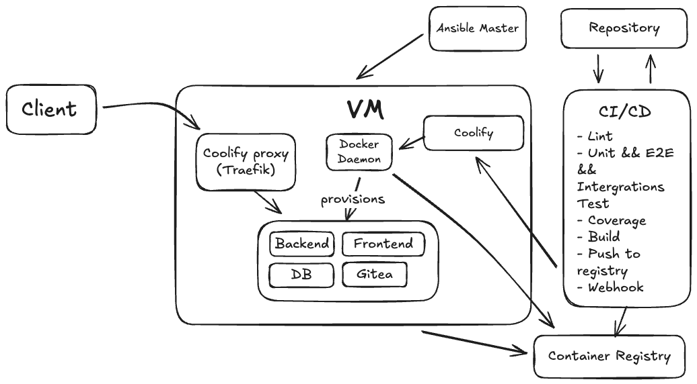
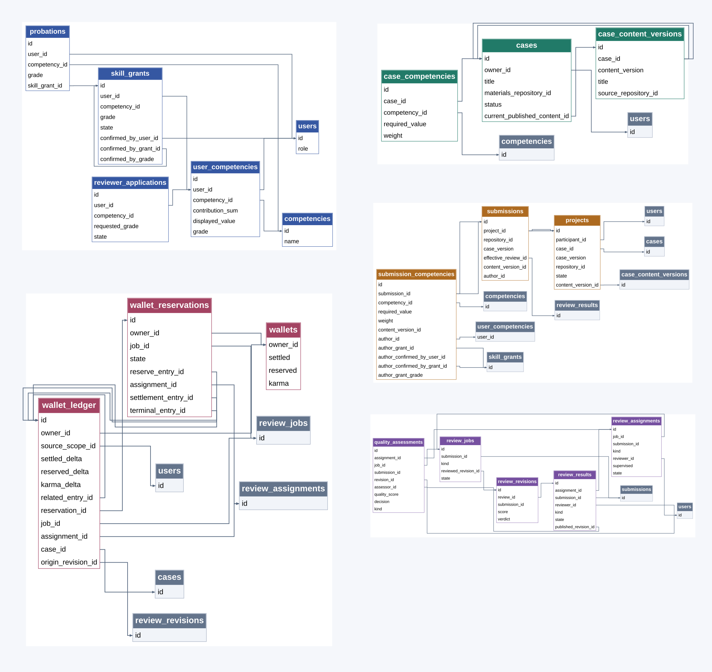
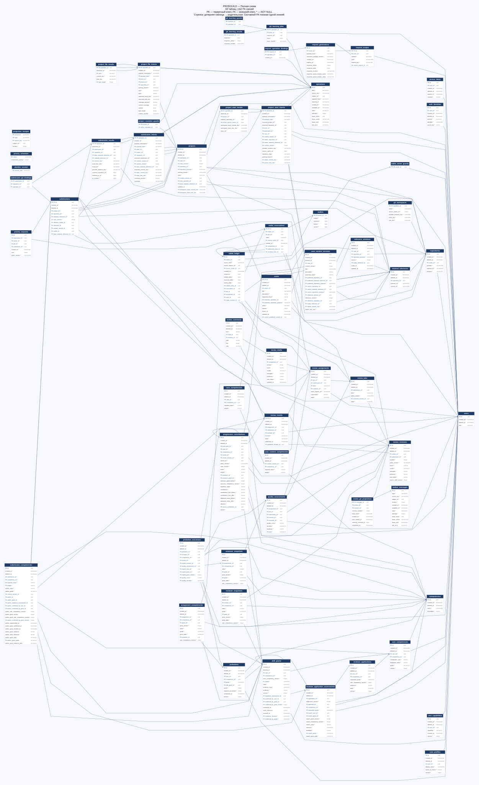
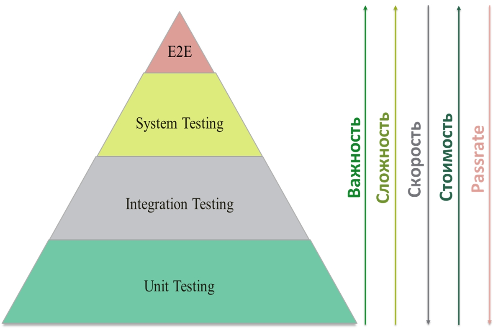
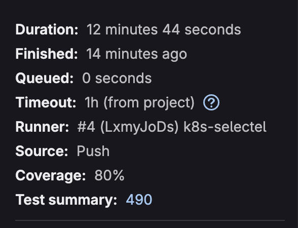
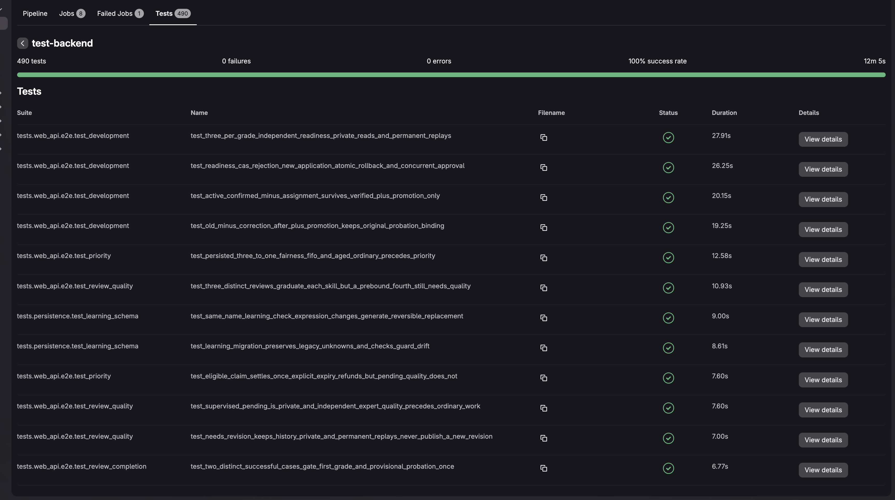

# RFC

## Функциональные требования

Кейсы (T01):
Каталог компетенций и опубликованных кейсов; создание и редактирование черновиков, текстовых материалов и приватного эталона; публикация.

Проекты и решения (T02):
Индивидуальный проект, редактирование файлов, одна отправка решения с зафиксированной версией; просмотр файлов и diff отправленного решения.

Назначение ревью (T03):
Подбор по всем необходимым компетенциям, запрет самопроверки, одно активное назначение; бессрочные задания с ручным возвратом; платный приоритет с очередью 3:1 и учётом времени ожидания.

Проведение ревью (T04):
Приватные черновики, оценка, вердикт, обратная связь и комментарии к строкам; исправления ревью и публикация результата; перенос опубликованного отзыва в комментарий PR.

Развитие и менторинг (T05):
Начисление XP и повышение грейда отдельно по навыкам; испытательный период с тремя экспертными подтверждениями; экспертная оценка ревью и готовности стать экспертом.

PRODиты и карма (T06):
Приветственные начисления, награды за успешный кейс и полезное ревью; покупка приоритета, резервирование, списание и возврат; баланс и история операций.

Профиль и история (T07):
Компетенции, грейды, права ревью, испытательный период, карма и баланс; история проектов и проверок, опубликованный фидбэк и объяснение прогресса.

## Нефункциональные требования

Сохранность данных:
Результаты, ревью, компетенции, права и финансовая история сохраняются между сеансами и перезапусками. Отправленные решения привязаны к неизменяемым версиям.

Разграничение доступа:
Сервер проверяет актуальные права и владение ресурсами. Черновики, эталоны и неопубликованные проверки доступны только уполномоченным пользователям.

Целостность операций:
Публикация результата, изменение прогресса и начисление наград выполняются атомарно. Повторные начисления и отрицательный доступный баланс исключены.

Идемпотентность и конкурентность:
Повтор запроса не дублирует действие. Проверки версий и блокировки защищают от потери изменений, двойного назначения и конкурентных списаний.

Устойчивость к сбоям:
Частично выполненные операции с Git допускают восстановление. Сбой переноса отзыва в Gitea не отменяет опубликованный результат и начисленные награды.

Безопасность API:
Входные данные, пути и размеры файлов валидируются; ошибки не раскрывают секреты и внутренние детали. Пароли хешируются, токены поддерживают отзыв.

Наблюдаемость:
Доступны метрики, логи и трассировки, а также отдельные проверки работоспособности приложения и доступности зависимостей.

Проверяемость и воспроизводимость:
Документированное REST API, автоматические unit-, интеграционные и E2E-тесты, отчёт о покрытии; инструкции запуска, тестовые данные и CI/CD со сборкой, проверками и развёртыванием.

Удобство интерфейса:
Адаптивность для компьютера и телефона; понятные состояния загрузки, ошибок и пустых результатов, сохранение пользовательских черновиков.

## Архитектура

Бек - модульный монолит на FastAPI:
- web_api - HTTP: роуты, валидация, сериализация, обработка ошибок
- application - сценарии, бизнес-правила и порты. домены и юзкейсы находятся вместе
- adapters - реализации портов: PostgreSQL через SQLAlchemy, Gitea через HTTPX, криптография
- web_api/ioc - сборка через Dishka, зависимости передаются через конструкторы. Engine, HTTP-клиент и worker живут на уровне приложения; сессия БД, адаптеры хранения и use cases - на уровне запроса

## Деплой

- Наливка вмки

  Джоба в CI: https://gitlab.t-education.com/hack-led-03/main/-/jobs/37384

  

Преднастройка вмки, установка Coolify, раскладка конфигов
- Релиз
  1. Патчим тег образов в Coolify
  2. Тригерим редеплой

  

Итоговый флоу:

## Миграции и наливка данных

- Миграции через alembic
- Скрипт для наливки тестовых юзеров, компетенций, кейсов, etc.: `utils/seeddata`

## ER

- users: пользователи платформы и их системные роли.
- competencies: справочник компетенций.
- user_competencies: накопленный XP, значение навыка и грейд пользователя.
- skill_grants: права пользователя на ревью по конкретным компетенциям.
- cases: учебные кейсы, условия, ожидаемый результат и статус публикации.
- projects: индивидуальные проекты участников по выбранным кейсам.
- submissions: отправленные решения, привязанные к зафиксированной версии проекта.
- review_assignments: назначения работ конкретным ревьюерам и состояние проверки.
- review_results: результаты ревью и ссылки на опубликованные версии.
- review_revisions: неизменяемые версии ревью с оценкой, вердиктом и обратной связью.
- quality_assessments: экспертные оценки качества ревью и рекомендации ревьюеру.
- progression_contributions: начисления XP по компетенциям и основания для них.
- wallets: баланс PRODитов, зарезервированные средства и карма пользователя.
- wallet_ledger: неизменяемая история начислений, списаний, резервов и возвратов.

Горячие таблички:

Расширенный вид:

## Обзервабилити

## Тестирование

Реализованы следующие виды тестов согласно пирамиде тестирования:

- *Unit-тесты*: XP, грейды, права ревьюеров, испытательный период, награды, стоимость приоритета и правила повторных запросов
- *Интеграционные тесты*: адаптеры, миграции, ограничения данных, транзакции, конкурентные операции, откаты, защита от двойных списаний/наград и восстановление публикаций
- *E2E тесты*: пользовательские сценарии - регистрация, кейсы, проекты, отправка решений, ревью и экспертное подтверждение, повышение грейдов, профиль/история, кошелёк и приоритет

Общее покрытие тестами и juint репорт можно увидеть в юайке GitLab CI:

